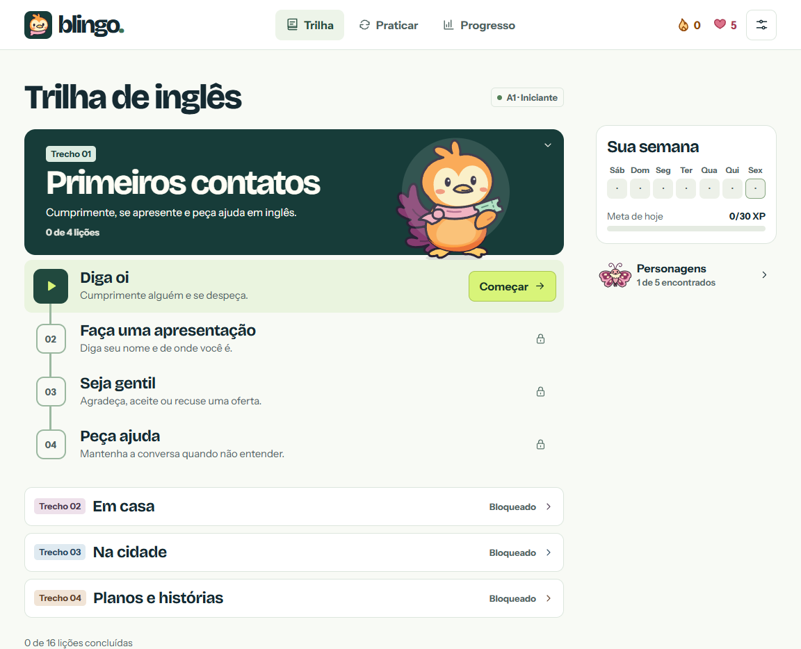
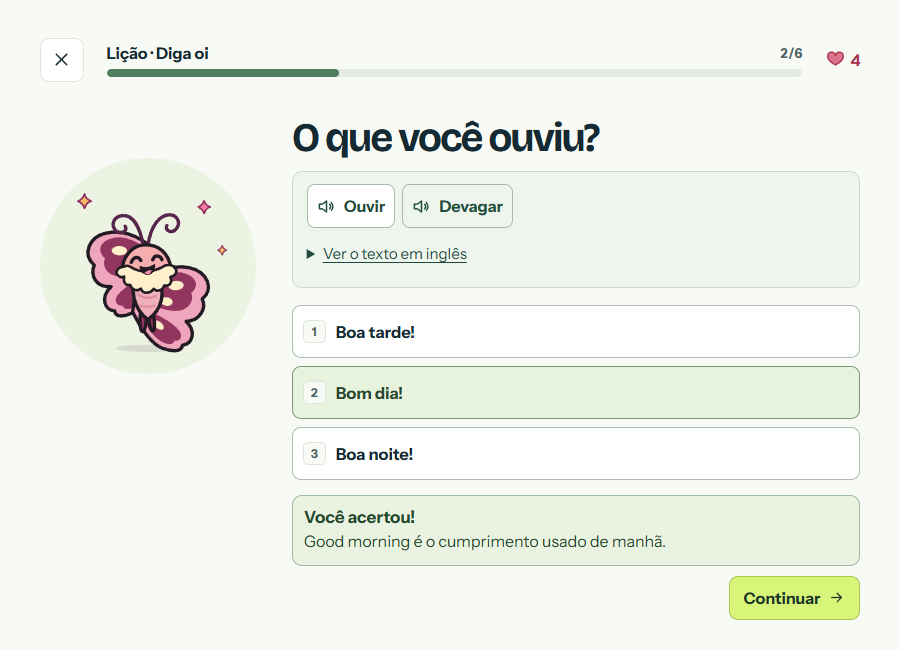
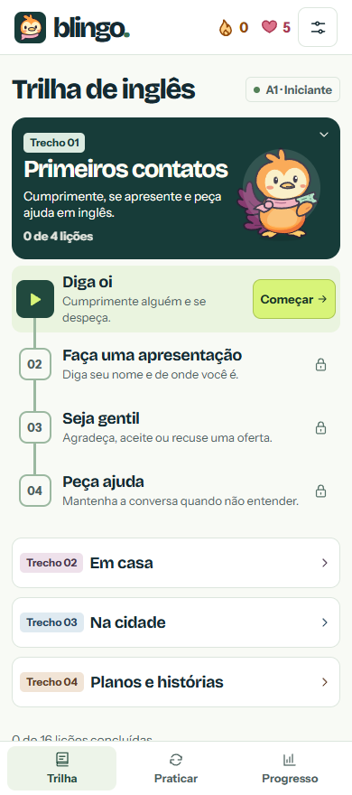

# Blingo

Inglês para brasileiros, com lições curtas e revisão espaçada.

[Baixar para Windows](https://github.com/jonuffykk/blingo/releases/latest) · [Notas de atualização](CHANGELOG.md) · [Contribuir](CONTRIBUTING.md)



São 16 lições e 96 exercícios. Você começa pelos cumprimentos e avança para situações do dia a dia. Na escuta, dá para repetir o áudio em dois ritmos. Na hora de escrever, você pode montar a frase ou digitar a resposta.

<p>
  
  
</p>

### Usar o Blingo

Baixe o executável para [Windows x64](https://github.com/jonuffykk/blingo/releases/latest/download/Blingo-Windows-x64.exe) ou [Windows ARM64](https://github.com/jonuffykk/blingo/releases/latest/download/Blingo-Windows-arm64.exe). Ele roda offline e usa o [WebView2](https://developer.microsoft.com/microsoft-edge/webview2/) do Windows. Os executáveis são portáteis e sem assinatura digital.

No Android, iOS, macOS e Linux, use a versão web. O repositório inclui a configuração da demo na Vercel. Depois da primeira visita, o navegador guarda os arquivos do curso para uso offline.

Cada instalação guarda perfis e progresso no próprio dispositivo. Para levar seus dados do navegador para o aplicativo, use **Configurações → Backup de progresso**.

### Rodar o projeto

Use Node.js 22.12 ou mais recente.

```sh
npm ci
npm run dev
```

`npm run build` gera o site em `dist/`. No Windows, `npm run desktop:build` compila o executável em `desktop/target/release/Blingo.exe`. Para esse build, instale Rust 1.88 ou mais recente e as ferramentas MSVC.

### Contribuir

Correções nas lições, no áudio, nas animações e na interface são bem-vindas. Faça um fork, abra um pull request e conte como testou. O [guia de contribuição](CONTRIBUTING.md) também explica como manter os releases e a demo.

### Créditos

O projeto surgiu do [Lingo](https://github.com/sanidhyy/duolingo-clone), de Sanidhya Kumar Verma. Os áudios de inglês foram produzidos com [Kokoro-82M](https://huggingface.co/hexgrad/Kokoro-82M). As licenças das fontes Bricolage Grotesque e Instrument Sans estão em [public/fonts](public/fonts). O código usa a [licença MIT](LICENSE).
